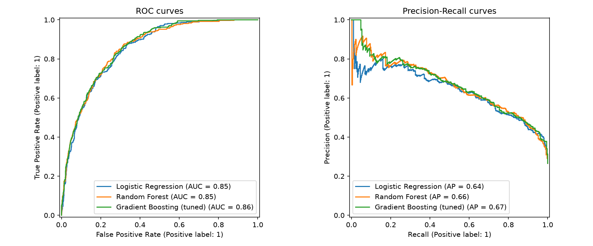
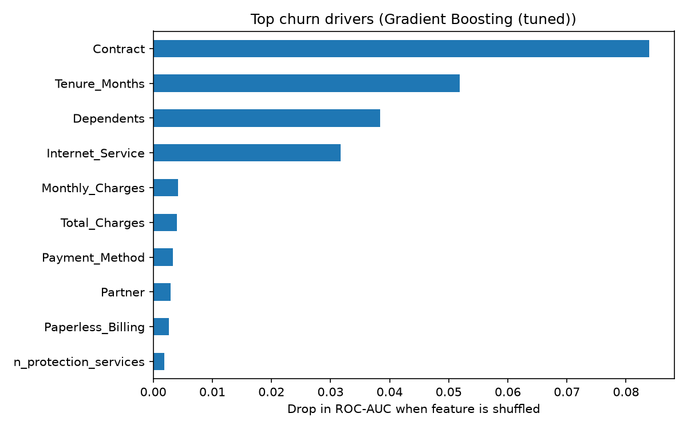
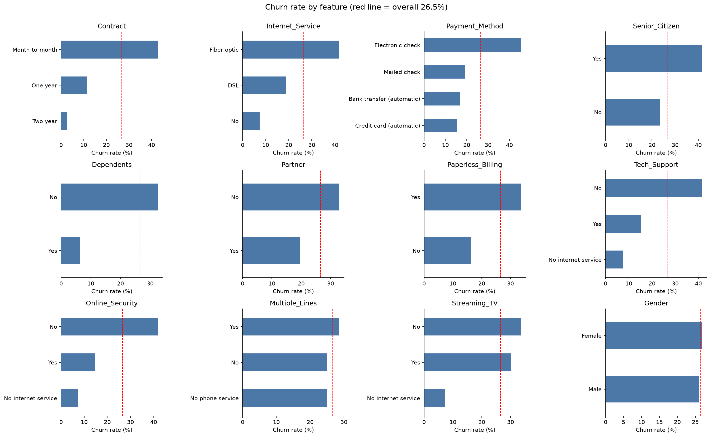
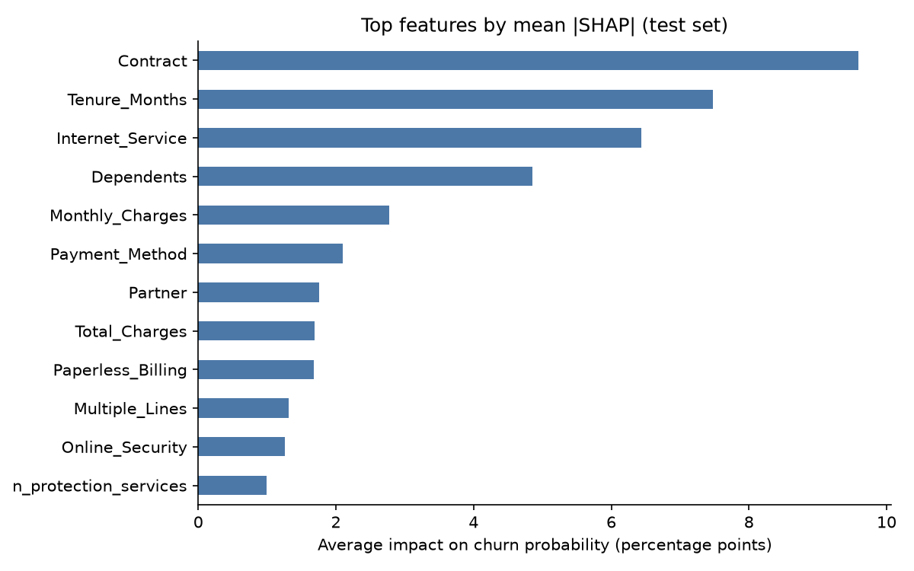
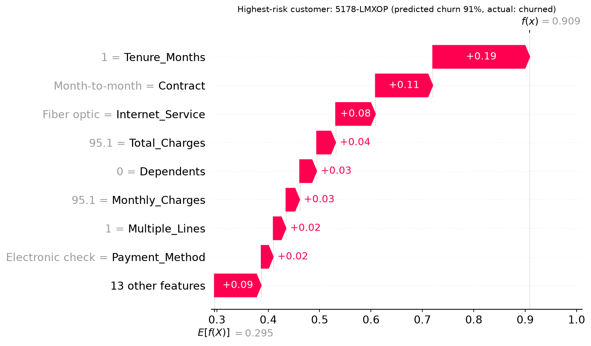
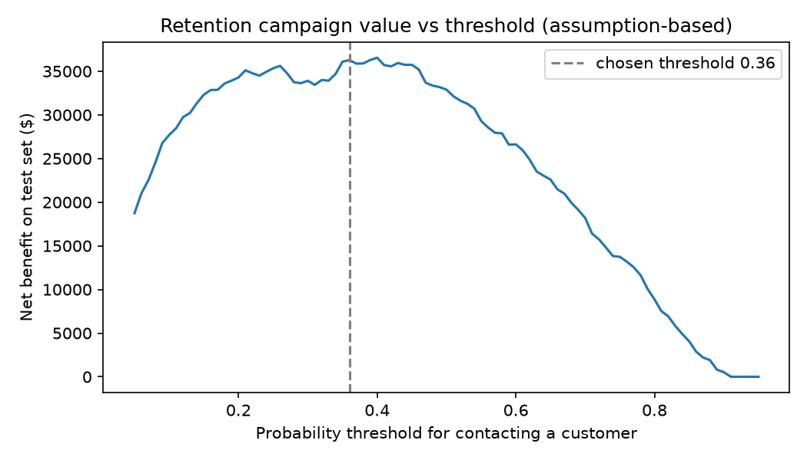

# Telco Customer Churn Prediction & Retention Targeting

Predicting which telecom customers are likely to churn, explaining **why**, and deciding **who a retention team should contact first**, using Python and scikit-learn. A Power BI dashboard built on the model output is in progress (see `powerbi/`).

## Business problem
Acquiring a new customer costs far more than keeping an existing one. A retention team has a limited budget, so it needs to know which customers are most at risk and what is driving them to leave, rather than contacting everyone.

## Dataset
IBM Telco Customer Churn sample dataset (a fictional California telecom company): **7,043 customers**, 33 columns covering demographics, services, contract, billing and churn outcome. **26.5%** of customers churned. See [`data/README.md`](data/README.md).

## Approach
1. **Removed data leakage** (notebook 01, section 10). This version of the dataset contains `Churn Score` (another model's output), `Churn Reason` (only recorded for customers who already left), `CLTV` and the churn label columns. Using them would inflate performance without being usable in practice, so they are excluded from the features. `Churn Reason` is used only for descriptive analysis.
2. **Dropped non-predictive fields.** Location columns (constant or high-cardinality) and gender (no business justification, avoids bias risk).
3. **Cleaned and engineered features.** Fixed blank `Total Charges` for brand-new customers, recoded "No internet/phone service" to "No" for add-ons, and created `n_protection_services`, `n_streaming_services` and `is_new_customer`.
4. **Leakage-safe modelling.** Stratified 80/20 split; preprocessing lives inside a scikit-learn `Pipeline`, so cross-validation never sees test-fold information.
5. **Compared three models:** logistic regression (interpretable baseline), random forest, and gradient boosting tuned with `RandomizedSearchCV` (scored on PR-AUC).
6. **Explained the model** with permutation importance, logistic-regression odds ratios and **SHAP** (global drivers plus a plain-language reason for each customer).
7. **Chose the contact threshold by business value**, using out-of-fold predictions on the training data only (see scenario below).

## Results (held-out test set, 1,409 customers)

| Model | CV ROC-AUC | Test ROC-AUC | Test PR-AUC |
|---|---|---|---|
| Logistic Regression | 0.860 | 0.849 | 0.640 |
| Random Forest | 0.858 | 0.854 | 0.664 |
| **Gradient Boosting (tuned)** | **0.864** | **0.858** | **0.671** |

PR-AUC from random guessing equals the churn rate (about 0.27), so the model is far above baseline.



### Lift
Customers ranked by predicted risk:

- The **top decile has a 76.6% churn rate**, 2.9x the average.
- The **top 20% of customers contains 51% of all churners.**
- The three lowest-risk deciles together contain only **2 of the 374 churners** (full table in `outputs/decile_analysis.csv`).

### What drives churn?


- **Contract type** is the strongest driver. Raw churn rates: month-to-month **42.7%**, one-year **11.3%**, two-year **2.8%**.
- **Tenure:** newer customers churn far more; in the logistic model, being in the first 12 months carries about 1.7x the odds of churning, holding other features constant.
- **Internet service:** fibre-optic customers churn at **41.9%** vs 19.0% for DSL, and have about 2x the odds of churning in the logistic model.
- **Dependents** and **no internet service** are strongly protective (odds ratios about 0.2 and 0.3).
- Among churned customers, the most common stated reasons relate to **competitor offers** (speed, data, better deal) and **support staff attitude**.



### Why is *this* customer at risk? (SHAP)
SHAP splits each customer's predicted churn probability into contributions from each feature (in percentage points, pp), so a retention team can see the specific reasons behind a score. Computed on the 1,409 held-out test customers (notebook 03).

- Average impact on churn probability: **contract type 9.5 pp, tenure 7.5 pp, internet service 6.4 pp, dependents 4.8 pp**, then monthly charges (2.8 pp) and payment method (2.1 pp).
- **Month-to-month contracts add about 8.2 pp** to a customer's risk, while **two-year contracts subtract about 12.8 pp**. **Fibre optic adds about 6.2 pp.**
- `outputs/shap_top_drivers_test.csv` lists the top 3 risk drivers for every test customer, e.g. *"Tenure_Months = 1 (+16.0 pp)"*, *"Contract = Month-to-month (+11.9 pp)"*.




SHAP explains what the *model* has learned from this dataset; it does not prove that changing a feature would cause customers to stay.

## Retention campaign scenario (assumption-based)
The threshold for contacting a customer is chosen to maximise net benefit under **illustrative assumptions** (editable in the notebook):

- Cost of contacting + discounting a customer: **$80**
- Share of contacted churners retained: **30%**
- Value of a saved customer: **12 x monthly charges**

At the chosen threshold (0.38), the model reaches **precision 0.59 and recall 0.71** on the test set. Under these assumptions, targeting by model gives roughly **$36K** net benefit on the test customers, vs **-$15K** if everyone were contacted. These figures are a scenario estimate based on stated assumptions, **not measured savings**.



## Limitations
- The data is a single snapshot with no time dimension, so the model cannot be validated on future periods.
- The dataset is a sample and may not reflect real-world customer behaviour.
- Campaign cost and save-rate figures are assumptions; real values should come from A/B tests.
- Probabilities were not calibrated.

## Project structure
```
Churn Prediction/
├── data/
│   ├── README.md                      # data source and dictionary notes
│   ├── Telco_customer_churn.xlsx      # raw data
│   └── processed/
│       └── telco_clean.csv            # cleaned data (created by notebook 01)
├── notebooks/
│   ├── 01_data_exploration.ipynb      # EDA, leakage check, saves cleaned data
│   ├── 02_churn_modeling.ipynb        # loads cleaned data: modelling, evaluation, export
│   └── 03_shap_explainability.ipynb   # SHAP: why is each customer at risk?
├── outputs/                           # charts + CSVs from notebooks 01-03
│   ├── customer_churn_scores.csv      # per-customer risk scores (Power BI source)
│   └── shap_top_drivers_test.csv      # top 3 risk drivers per test customer
├── tests/
│   └── test_project.py                # data-quality, leakage and model sanity tests
├── powerbi/                           # dashboard (in progress)
├── requirements.txt
└── README.md
```

## How to run
```bash
python -m venv .venv
.venv\Scripts\activate          # Windows  (macOS/Linux: source .venv/bin/activate)
pip install -r requirements.txt
```
Run the notebooks **in order** in VS Code or Jupyter (Run All in each, about 5 minutes in total):
1. `notebooks/01_data_exploration.ipynb` explores the raw data and writes `data/processed/telco_clean.csv`.
2. `notebooks/02_churn_modeling.ipynb` loads that file, trains and evaluates the models, and writes charts and `customer_churn_scores.csv` to `outputs/`.
3. `notebooks/03_shap_explainability.ipynb` loads the saved model and produces the SHAP explanations (about 2 minutes).

Pipeline: `raw xlsx -> 01 -> data/processed -> 02 -> outputs -> Power BI`, with `03` explaining the model from 02.

## Tests
After running the notebooks:
```bash
pytest -v
```
13 checks cover: no leakage columns, one row per customer, no missing features, a binary target with a plausible churn rate, valid probabilities, consistent threshold and risk bands, models beating random guessing, top-decile lift, and a complete SHAP driver table. Tests skip with a hint if a notebook has not been run yet.

## Next steps
- Power BI dashboard: executive overview, churn drivers, and a customer risk list (see `powerbi/README.md`).
- Probability calibration.
- Compare against XGBoost / LightGBM and a Streamlit app for scoring a single customer.
- Test uplift modelling (who is *persuadable*), not just who is likely to churn.

## Tools
Python, pandas, NumPy, scikit-learn, SHAP, matplotlib, pytest, Jupyter, Power BI (planned)

## Author
Siddhesh Kadam | [LinkedIn](https://linkedin.com/in/siddheshkadam12) | [GitHub](https://github.com/Siddhesh1206)
